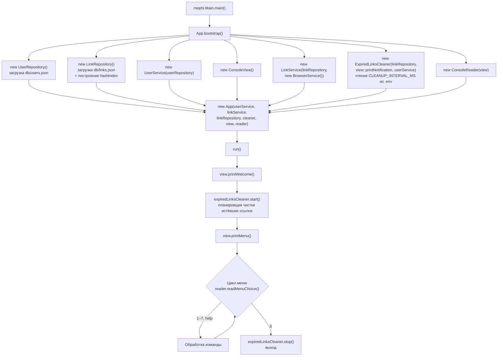
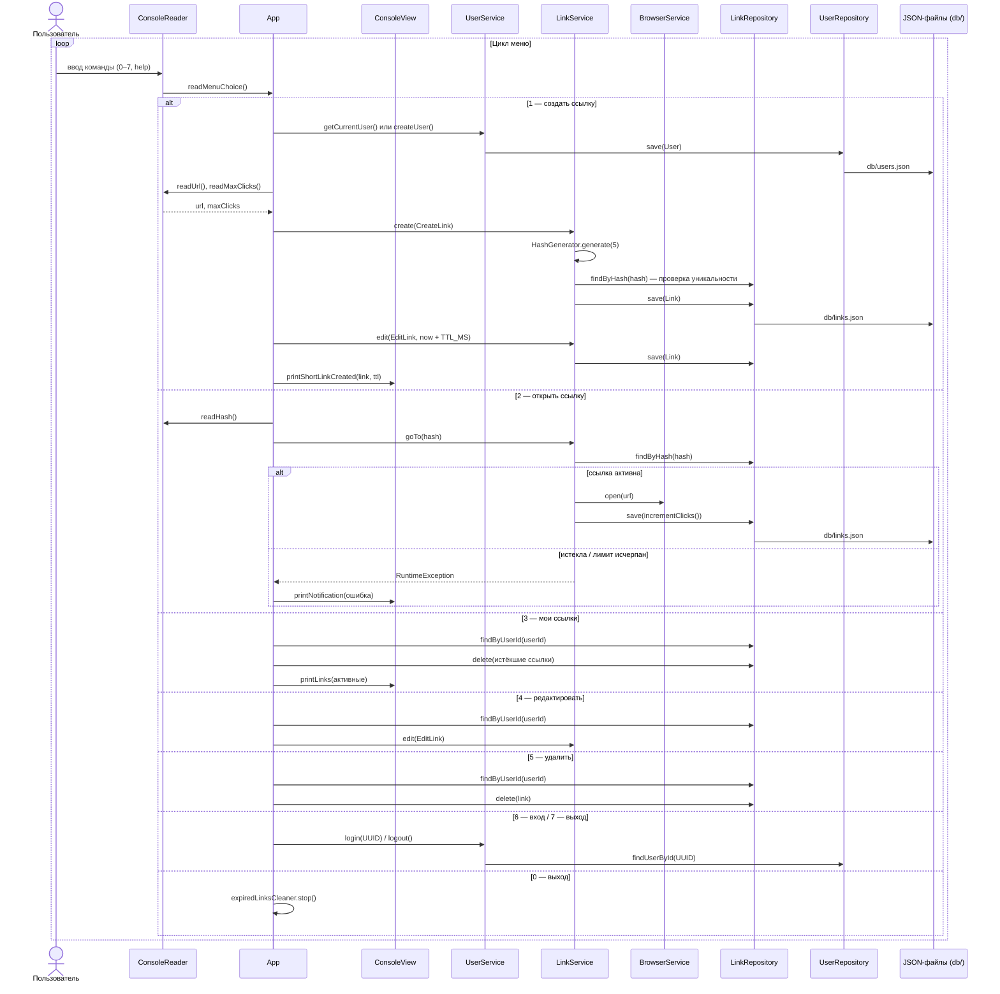
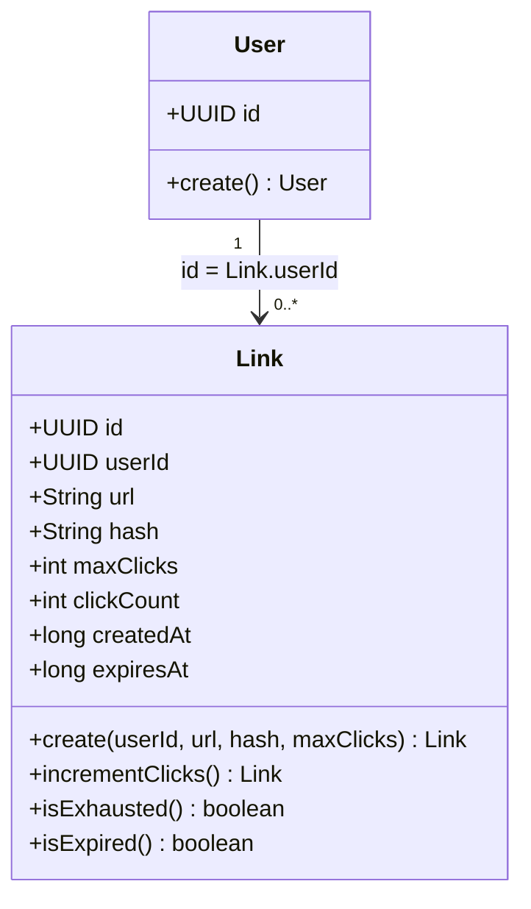

# Приложение «сервис сокращения ссылок» (Link Shortnener cli)

Итоговый проект (сессионное задание). Программирование на языке Java

---

## Архитектура приложения

Проект спроектирован с упором на принципы SOLID, слабую связанность и явное разделение ответственности. В основе лежит многослойная архитектура

## Компоненты архитектуры:

* Слой модели: инкапсулирует бизнес-правила системы (service) и логику персистентности данных (repository). Сервисы изолированы от консольного вывода и оперируют чистыми данными.
* Слой Представления: разделен на 3 класса
    * App - собирает в себе все необходимые сервисы, управляет логикой выполнения команд, координирует потоки данных между сервисами и выводом 
    * ConsolerReader - чтение команд пользователя
    * ConsleView - глупый компонент, отвечающий только за вывод информации
* Ядро: содержит в себе абстракцию файлового репозитория
## Диаграммы взаимодействия
### 1. Инициализация приложения



### 2. Поток данных при выполнении команд



### 3. Связи моделей



## Структура пакетов проекта
```
└── mephi
    ├── cli
    │   ├── App.java
    │   ├── ConsoleReader.java
    │   └── ConsoleView.java
    ├── core
    │   └── FileRepository.java
    ├── dto
    │   ├── CreateLink.java
    │   └── EditLink.java
    ├── Main.java
    ├── model
    │   ├── Link.java
    │   └── User.java
    ├── repository
    │   ├── LinkRepository.java
    │   └── UserRepository.java
    └── service
        ├── BrowserService.java
        ├── ConfigService.java
        ├── ExpiredLinksCleaner.java
        ├── HashGenerator.java
        ├── LinkService.java
        └── UserService.java
```
## Сборка и запуск проекта

```bash
cp example.env .env
```
Сборка проекта:
```bash
mvn clean package
```
Запуск:
```bash
mvn exec:java -Dexec.mainClass="mephi.Main"
```

Сборка и запуск через podman (docker):

```bash
podman build -t link-short .  
```

```bash
podman run -it --rm \
  -v $(pwd)/data:/data:Z \
  -v $(pwd)/.env:/data/.env:ro,Z \
  link-short:latest
```

## Справка по командам
```
1 - Сократить ссылку
2 - Перейти по короткой ссылке
3 - Мои ссылки
4 - Изменить лимит переходов
5 - Удалить ссылку
6 - Войти по UUID
7 - Выйти из аккаунта
0 - Выход
help - вывод спправки
```

## Технологический стек
* Язык: Java 17+
* Google Gson (работа с файловой БД в формате JSON)
* Lombok (инструмент кодогенерации на этапе компиляции)
* Сборка проекта: Maven
* Визуализация архитектуры: Mermaid.js (интегрировано в GitHub Markdown)
